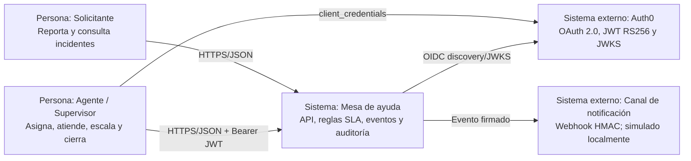

# C4 — Nivel 1: Contexto

El sistema centraliza tickets de soporte, asignaciones y escalaciones con control de SLA. Auth0 es el proveedor de identidad y el canal externo recibe notificaciones firmadas.

## Responsabilidades y límites

| Elemento | Responsabilidad | Fuera de alcance |
|---|---|---|
| Mesa de ayuda | Persistir y proteger recursos; aplicar SLA; publicar/consumir eventos; notificar. | Interfaz gráfica de usuario final. |
| Auth0 | Emitir JWT para el cliente M2M y publicar claves de firma. | Administración de usuarios del dominio. |
| Canal externo | Aceptar únicamente payloads cuya firma HMAC sea válida. | Integración real con Slack/Teams; se usa un receptor reproducible. |
| Solicitante | Origina y consulta tickets. | Login interactivo; la consigna usa M2M. |
| Agente/Supervisor | Ejecuta operaciones sensibles según scopes. | Asignación automática avanzada por carga. |

La frontera de confianza principal es la API: no confía en claims sin validar el JWT ni en webhooks sin secreto compartido.
