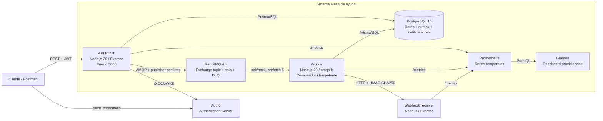

# C4 — Nivel 2: Contenedores

Esta vista coincide con los servicios declarados en `docker-compose.yml`.

## Catálogo de contenedores

| Contenedor | Tecnología | Responsabilidad | Persistencia |
|---|---|---|---|
| API | Express, Prisma, Zod, Pino | REST, autenticación/autorización, reglas de aplicación, transacción y outbox. | PostgreSQL. |
| Worker | Node.js, amqplib, Prisma | Consumir eventos, deduplicar, persistir efecto y enviar webhook. | PostgreSQL por `evento_id` único. |
| Webhook receiver | Express, crypto | Verificar HMAC sobre body crudo y simular canal externo. | Últimas 100 recepciones en memoria; logs JSON. |
| PostgreSQL | 16-alpine | Entidades, historial, SLA, outbox y notificaciones. | Volumen Docker. |
| RabbitMQ | 4.2-management | Exchange topic, cola durable y dead-letter queue. | Volumen Docker. |
| Prometheus | 3.x | Scraping y almacenamiento de métricas. | Volumen Docker, retención 7 días. |
| Grafana | 12.x | Dashboard p95/throughput/error rate. | Provisioning versionado y volumen. |

## Protocolos

- HTTP/JSON para API y webhook.
- OAuth 2.0 sobre HTTPS con Auth0.
- AMQP 0-9-1 entre API/worker y RabbitMQ.
- SQL/TCP entre Prisma y PostgreSQL.
- Exposición Prometheus para métricas.
