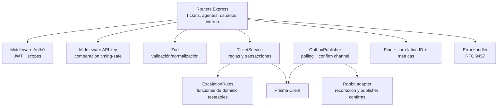
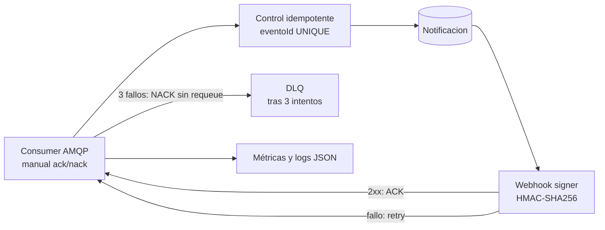

# C4 — Nivel 3: Componentes

## Contenedor API

| Componente | Archivo principal | Motivo de separación |
|---|---|---|
| Routers | `src/routes/*.js` | Traduce HTTP a casos de uso; no contiene las reglas complejas. |
| Validación | `src/validation/schemas.js` | Rechaza campos desconocidos y limita tamaños antes de tocar datos. |
| Seguridad | `src/middleware/auth0.js`, `apiKey.js` | Centraliza autenticación y autorización. |
| Servicio de tickets | `src/services/ticketService.js` | Coordina persistencia y transacciones. |
| Reglas de escalamiento | `src/services/escalationRules.js` | Lógica pura con tests unitarios, independiente de Express/Prisma. |
| Outbox publisher | `src/messaging/outboxPublisher.js` | Separa confirmación de negocio de disponibilidad del broker. |
| Rabbit adapter | `src/messaging/rabbit.js` | Administra conexión, exchange y confirm channel. |
| Observabilidad | `metrics.js`, `correlationId.js`, Pino | Mide y correlaciona sin contaminar reglas de dominio. |
| Errores | `AppError.js`, `errorHandler.js` | Uniforma códigos y `application/problem+json`. |

## Contenedor worker

El worker es deliberadamente **at-least-once**: RabbitMQ puede reentregar. La restricción única `notificaciones.evento_id` hace que una reentrega ya completada se reconozca y se confirme sin duplicar el webhook.
