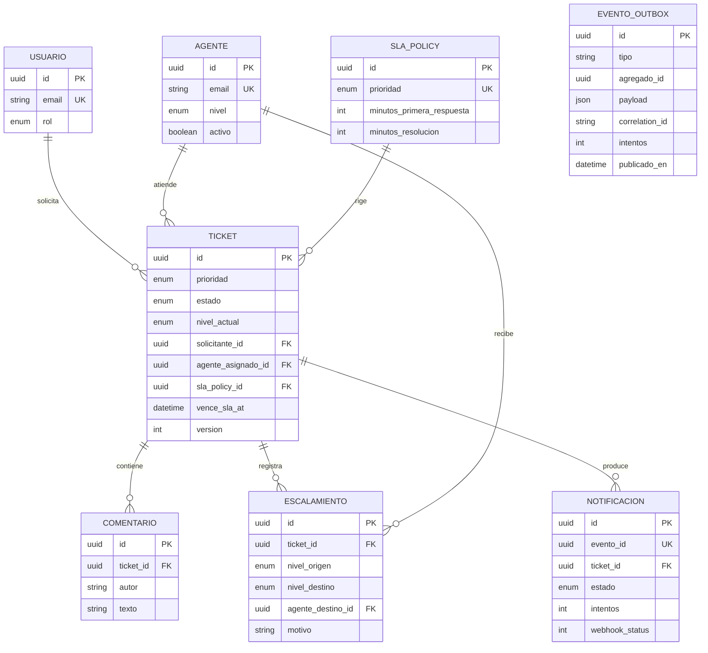

# Modelo de datos

PostgreSQL 16 con Prisma. Las migraciones versionadas son `0001_init` y `0002_final_delivery`; `prisma migrate deploy` las aplica automáticamente al iniciar la API.



`EventoOutbox` no tiene FK al ticket intencionalmente: es un registro de integración que debe poder sobrevivir a cambios del agregado. `Notificacion` sí referencia al ticket porque es el efecto consultable por la API.

## Invariantes relevantes

- Emails de usuario/agente y prioridad SLA son únicos.
- Un ticket siempre referencia solicitante y política SLA existentes.
- `version` implementa comparación optimista durante el escalamiento.
- `evento_id` único vuelve idempotente al consumidor.
- Un agente de destino debe estar activo y pertenecer exactamente al nivel siguiente.
- Un ticket cerrado es inmutable y los recursos con historial no se borran.

## Cálculo de SLA

Al crear un ticket:

```text
venceSlaAt = instanteCreacion + slaPolicy.minutosResolucion
```

Para prioridades `ALTA` y `CRITICA` se permite escalamiento inmediato. Para `MEDIA` y `BAJA` se habilita al entrar en la ventana de riesgo:

```text
atRiskAt = venceSlaAt - slaPolicy.minutosPrimeraRespuesta
```

Escalar no reinicia el vencimiento: reiniciarlo ocultaría un incumplimiento y permitiría “ganar tiempo” mediante sucesivas escalaciones.

## Transacción de escalamiento

Con aislamiento `Serializable`:

1. leer ticket con agente y política;
2. validar invariantes;
3. elegir/verificar agente de nivel siguiente;
4. insertar historial `Escalamiento`;
5. actualizar `Ticket` solo si `version` no cambió;
6. insertar `EventoOutbox` con payload y correlation ID;
7. commit único.

Si cualquier paso falla, PostgreSQL revierte todos. La entrega a RabbitMQ ocurre después y no forma parte de la transacción SQL.

## Seed reproducible

`prisma/seed.js` usa `upsert` para SLA, usuarios y agentes, y comprueba la existencia del ticket de muestra. Puede ejecutarse en cada arranque sin duplicar datos funcionales.
